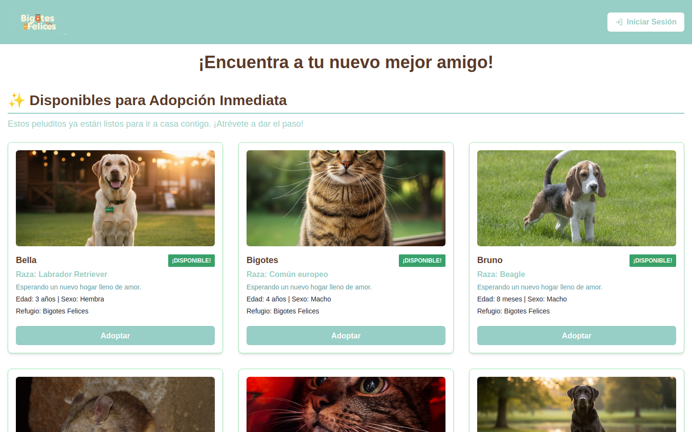
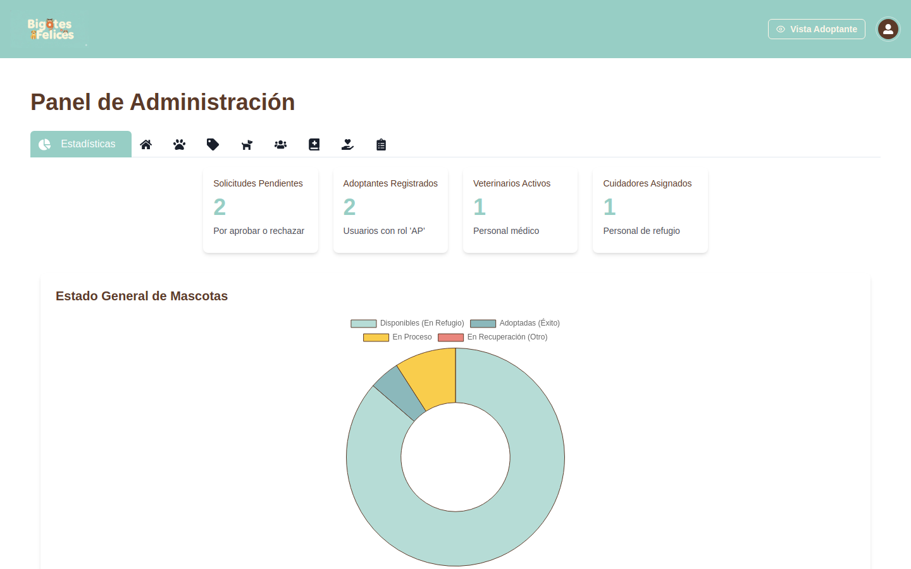
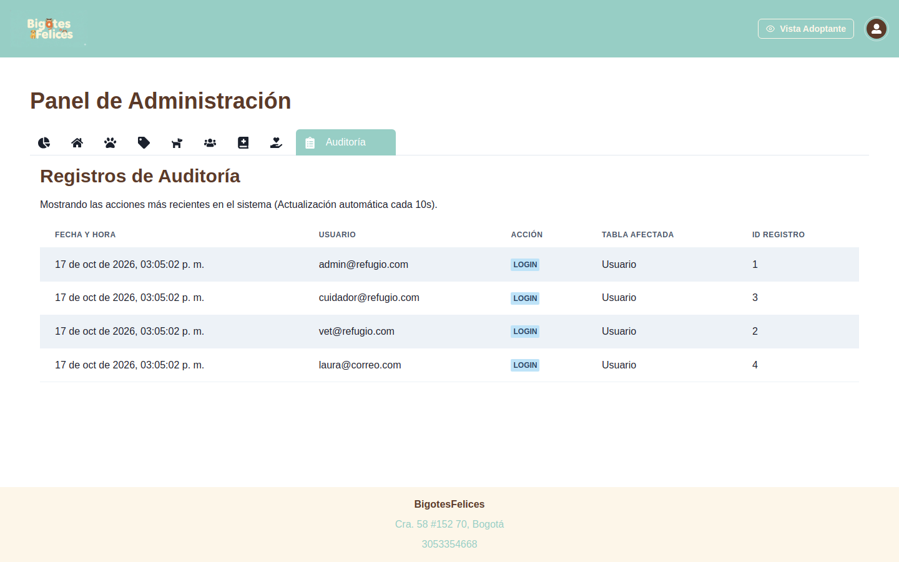
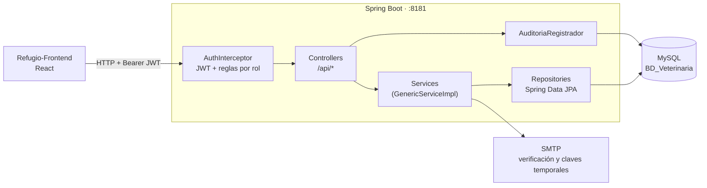
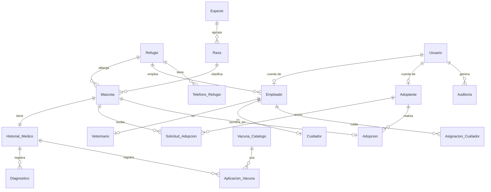

<div align="center">

# 🐾 Bigotes Felices — Backend

**API REST del refugio de mascotas Bigotes Felices.**
Adopciones, historial clínico, vacunación, turnos de cuidadores, personal y auditoría, con control de acceso por rol.


Frontend: **[Refugio-Frontend](https://github.com/JuaniMP/Refugio-Frontend)** (React + Chakra UI)

</div>

---

## 📑 Contenido

- [Qué hace](#-qué-hace)
- [Capturas](#-capturas)
- [Arquitectura](#-arquitectura)
- [Seguridad](#-seguridad)
- [Patrones de diseño](#-patrones-de-diseño)
- [Modelo de datos](#-modelo-de-datos)
- [Cómo ejecutarlo](#-cómo-ejecutarlo)
- [Cómo probarlo](#-cómo-probarlo)
- [API](#-api)

---

## ✨ Qué hace

- **Adopción:** catálogo público de mascotas, registro de adoptantes con verificación por correo, solicitudes y aprobación.
- **Salud:** historial médico por mascota, diagnósticos y vacunas aplicadas. Un veterinario solo atiende las especies de su especialidad.
- **Cuidado diario:** los cuidadores inician y terminan su turno y dejan una bitácora por mascota de su zona.
- **Personal:** el administrador da de alta veterinarios y cuidadores; cada uno recibe por correo una contraseña temporal que debe cambiar al primer ingreso.
- **Auditoría:** cada alta, cambio, borrado e inicio de sesión queda registrado con su autor.

---

## 📸 Capturas

| Catálogo público | Ficha clínica (veterinario) |
|---|---|
|  |  |

| Estadísticas (admin) | Auditoría |
|---|---|
|  |  |

Más capturas, una por rol, en el [README del frontend](https://github.com/JuaniMP/Refugio-Frontend#-capturas-por-rol).

---

## 🏗 Arquitectura



---

## 🔐 Seguridad

| Aspecto | Implementación |
|---|---|
| **Autenticación** | JWT firmado (HS256). `AuthInterceptor` lo valida en **cada** petición a `/api/**`. |
| **Autorización** | Reglas por rol en un solo lugar (`security/AuthInterceptor`): visitante, adoptante (`AP`), veterinario (`V`), cuidador (`C`) y administrador (`AD`, acceso total). |
| **Contraseñas** | BCrypt. Las cuentas antiguas (SHA‑256) siguen funcionando y se migran a BCrypt automáticamente en su siguiente inicio de sesión. |
| **Datos sensibles** | El hash de la contraseña y los códigos de verificación nunca se devuelven en JSON. |
| **Secretos** | Contraseñas de base de datos, correo y JWT solo por variables de entorno. |
| **CORS** | Orígenes permitidos configurables (`CORS_ORIGINS`), no `*`. |

---

## 🧩 Patrones de diseño

| Patrón | Dónde | Para qué |
|---|---|---|
| **Arquitectura en capas** | `controller/` → `service/` → `repository/` | Separar HTTP, negocio y datos. |
| **Repository** | `repository/*Repository.java` | Acceso a datos con Spring Data. |
| **Servicio genérico** | `utils/GenericServiceAPI` + `GenericServiceImpl` | Los 18 servicios heredan el CRUD básico en lugar de repetirlo. |
| **Template Method** | `controller/CatalogoController<T>` | Especies, razas y vacunas comparten listar/guardar/borrar con auditoría; cada una solo define sus textos y reglas (p. ej. raza única por especie). |
| **Interceptor (Chain of Responsibility)** | `security/AuthInterceptor` registrado en `config/WebConfig` | Autenticación y autorización antes de llegar al controlador. |
| **Componente compartido** | `security/SesionActual`, `security/AuditoriaRegistrador` | Leer el token y auditar: antes estaban copiados en 17 controladores. |
| **Builder** | `@Builder` de Lombok en entidades | Construcción legible de objetos. |
| **Herencia por clave compartida** | `Veterinario` y `Cuidador` con `@MapsId` sobre `Empleado` | Datos comunes del empleado en una sola tabla. |

---

## 🗄 Modelo de datos

18 tablas en `BD_Veterinaria` ([`database/01_schema.sql`](database/01_schema.sql)):



---

## 🚀 Cómo ejecutarlo

### Requisitos

- Java 17+ (Gradle se descarga solo con `./gradlew`)
- MySQL 8+
- [Mailpit](https://mailpit.axllent.org/) (opcional) para ver los correos en local

### 1. Base de datos

```bash
./database/setup.sh          # crea BD_Veterinaria, el esquema y los datos de demostración
```

Variables opcionales: `MYSQL_USER`, `MYSQL_PWD`, `MYSQL_HOST`, `DEMO=0` (sin datos de demostración).

### 2. Backend

```bash
SPRING_PROFILES_ACTIVE=dev ./gradlew bootRun     # http://localhost:8181
```

El perfil `dev` usa MySQL en `localhost` y envía los correos a Mailpit (`http://localhost:8025`).
Para cualquier otro entorno define las variables:

| Variable | Descripción |
|---|---|
| `DB_URL` / `DB_USER` / `DB_PASSWORD` | Conexión MySQL (por defecto `localhost`, `root`, vacía) |
| `JWT_SECRET` | **Obligatoria** fuera de `dev`: 32+ caracteres aleatorios |
| `MAIL_USERNAME` / `MAIL_PASSWORD` | Gmail con contraseña de aplicación |
| `CORS_ORIGINS` | URLs del frontend separadas por comas (por defecto `http://localhost:5173`) |

### Usuarios de demostración

Contraseña de todos: **`Demo1234*`**

| Rol | Usuario |
|---|---|
| Administrador | `admin@refugio.com` |
| Veterinario (Cirugía General) | `vet@refugio.com` |
| Cuidador (Patio Perros Grandes) | `cuidador@refugio.com` |
| Adoptantes | `laura@correo.com`, `andres@correo.com` |

---

## 🧪 Cómo probarlo

```bash
./gradlew test
```

| Prueba | Qué verifica |
|---|---|
| `AuthInterceptorTest` | Rutas públicas, 401 sin sesión, 403 con rol incorrecto, acceso total del admin, cuentas inactivas. |
| `HashPassTest` | BCrypt para claves nuevas y compatibilidad con las cuentas SHA‑256. |
| `RefugioBackendApplicationTests` | Que la aplicación arranca completa (necesita el MySQL de `setup.sh`). |

Prueba rápida con `curl`:

```bash
# Público
curl http://localhost:8181/api/mascotas/getAll

# Protegido: sin token → 401
curl -i http://localhost:8181/api/usuarios/getAll

# Con token de administrador
TOKEN=$(curl -s -X POST http://localhost:8181/api/usuarios/login \
  -H 'Content-Type: application/json' \
  -d '{"login":"admin@refugio.com","clave":"Demo1234*"}' | sed -E 's/.*"token":"([^"]+)".*/\1/')
curl -H "Authorization: Bearer $TOKEN" http://localhost:8181/api/usuarios/getAll
```

---

## 🔌 API

Base: `/api`. Formato JSON.

| Recurso | Endpoints | Acceso |
|---|---|---|
| Autenticación | `POST /usuarios/login` · `/verify-account` · `/forgot-password` · `/reset-password` | Público |
| Cambio de clave temporal | `POST /usuarios/force-reset-password` | Con sesión |
| Mascotas | `GET /mascotas/getAll` · `GET /mascotas/{id}` | Público |
| | `GET /mascotas/by-zona?zona=` | Cuidador |
| | `GET /mascotas/secure-search/{id}` | Veterinario (según especialidad) |
| | `POST /mascotas/save` · `DELETE /mascotas/{id}` | Admin |
| Adoptantes | `POST /adoptantes/save` (registro público; editar exige ser el dueño) · `GET /adoptantes/me` | Público / Adoptante |
| Solicitudes | `POST /solicitudes/save` · `GET /solicitudes/by-adoptante/me` | Adoptante |
| | `GET /solicitudes/getAll` · `POST /solicitudes/{id}/aprobar` | Admin |
| Salud | `/historiales/**` · `/diagnosticos/**` · `/aplicaciones-vacuna/**` · `GET /vacunas/getAll` | Veterinario |
| Turnos | `/asignaciones/comenzar-turno` · `/terminar-turno` · `/mi-turno-activo` · `/guardar-comentario` · `GET /cuidadores/me` | Cuidador |
| Catálogos | `GET /especies/getAll` · `/razas/getAll` · `/refugios/getAll` · `/telefonos-refugio/getAll` | Público |
| | `save`, `GET/DELETE /{id}` de especies, razas, vacunas, refugios y teléfonos | Admin |
| Personal | `POST /empleados/create-vet` · `/empleados/create-cuidador` · `/veterinarios/**` · `/cuidadores/**` | Admin |
| Auditoría | `GET /auditorias/getAll` | Admin |

---

<div align="center">

Hecho por **[Juanita Mejía](https://github.com/JuaniMP)**

</div>
